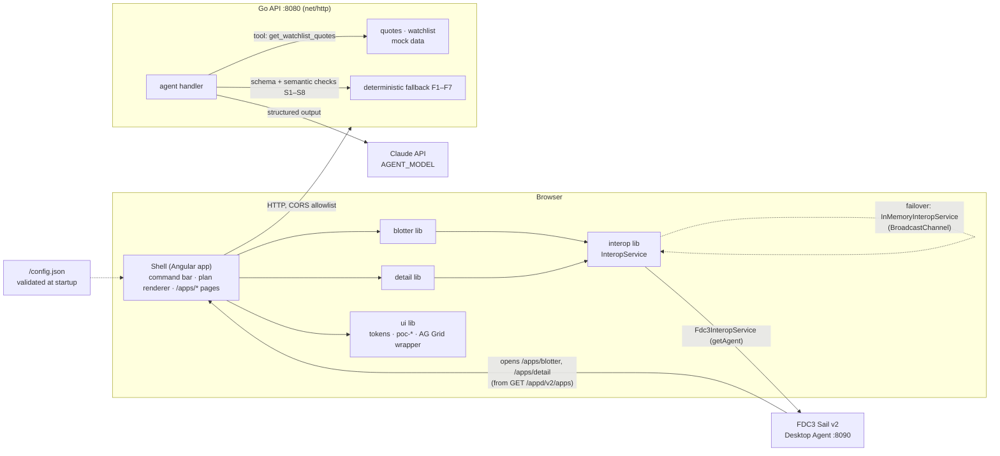

# Angular Interop POC

[](https://github.com/Justin-Medas/angular-interop-poc/actions/workflows/ci.yml)
[](https://github.com/Justin-Medas/angular-interop-poc/actions/workflows/fresh-clone.yml)

An Angular 22 shell with two FDC3-connected micro-apps (Blotter → Detail), a contract-first Go API, and a Claude-backed endpoint that plans which UI modules to load. The agent returns validated data, never UI. A deterministic fallback covers every failure, and a pass-rate eval measures the model.

Reports for the latest `main`: <https://justin-medas.github.io/angular-interop-poc/> (Go and Angular coverage, Playwright report). Each CI run's summary page also shows the coverage tables.

## What it shows
- **Interop (G1, G2).** Selecting a Blotter row broadcasts `fdc3.instrument`; Detail follows. The row menu's **View chart** raises the `ViewChart` intent and Detail opens its chart tab. This works through FINOS FDC3 Sail across tabs, or through an in-memory adapter when no Desktop Agent is present.
- **Contract-first API (G3).** Quotes, history and watchlist come from deterministic mock data. Every response is validated against `specs/openapi.yaml` in contract tests.
- **Agentic workspace planning (G4).** `POST /agent/select-module` turns a sentence into a `WorkspacePlan` (1–3 modules plus an optional `fdc3Action`). The model may call one read-only tool, `get_watchlist_quotes`, at most 3 times.
- **Measured nondeterminism (G5).** 26 eval cases, 3 runs each, graded deterministically (no LLM judge). Latest recorded live run: model 100% (66/66, threshold 90%), fallback 100% (12/12), p95 2456 ms. See [`docs/eval-report.md`](docs/eval-report.md).
- **Swappable seams (G6).** Components inject `InteropService` and use `poc-*` wrappers. ESLint import boundaries enforce both.
- **Accessible and themed (G7).** WCAG 2.2 AA checks with axe, dark and light themes from design tokens.

## Architecture



How a request flows:
1. The user types a request in the shell's command bar. The shell calls `POST /agent/select-module`.
2. The Go handler asks Claude for a `WorkspacePlan` using structured outputs (`specs/agent-tool-schema.json`). Claude may call `get_watchlist_quotes` first.
3. The result is validated against the schema and the semantic checks (SPEC §7.3). On any failure (no key, timeout, refusal, invalid output, tool limit) the deterministic fallback answers and the response says `"source": "fallback"` with the reason.
4. The shell maps each `module` to a lazy-loaded component, announces the rationale in a live region and performs the optional broadcast through `InteropService`.

Where to look:

| Path | What |
|---|---|
| `specs/` | Source of truth: SPEC, OpenAPI, FDC3 contract, agent schema, mock data, tokens, accessibility, testing |
| `api/` | Go module: `internal/quotes`, `internal/agent`, `internal/mock`, `internal/httpx`, `evals/` runner |
| `web/projects/shell` | The Angular application |
| `web/projects/{blotter,detail,ui,interop}` | Libraries. `ui` owns tokens and the only AG Grid import; `interop` owns the only `@finos/fdc3` import |
| `web/e2e` | Playwright functional, axe and visual tests |
| `docs/` | [`PLAN.md`](docs/PLAN.md), [`DECISIONS.md`](docs/DECISIONS.md) (numbered decision log), eval report |

## Quickstart
Pick one. Each is exercised from a clean clone on macOS, Linux and Windows by the `fresh-clone` workflow.

**Docker** (only Docker required). The first build takes several minutes because it builds Sail.
```bash
docker compose up --build   # API :8080, Angular shell :4200, FDC3 Sail :8090
```

**Dev Container / Codespaces.** Open the repo in a Codespace, or choose "Reopen in Container" in VS Code. (A Codespaces-specific config variant is not done yet; see limitations.)

**Native** (Node per `.nvmrc`, Go ≥ 1.21 to bootstrap the pinned toolchain):
```bash
npm run setup     # checks toolchain, installs git hooks, fetches + builds FDC3 Sail at a pinned commit
npm start         # Go API :8080, Angular shell :4200, and Sail :8090 if installed (Ctrl+C stops all)
npm test          # Go unit tests, then Angular unit tests
```

Put `ANTHROPIC_API_KEY` in a repo-root `.env` (gitignored; template in `.env.example`) to enable the live agent. Without it the deterministic fallback answers. `AGENT_MODEL` defaults to `claude-sonnet-5-5`; `claude-opus-5-5` is opt-in.

### Try the demo
1. Open Sail at <http://localhost:8090>. The app directory is pre-registered, so open **Blotter** and **Detail** from it.
2. Click a Blotter row (or arrow to it and press Enter). Detail updates.
3. Right-click a row, or press Shift+F10, and choose **View chart**. Detail switches to its chart tab.
4. Open the shell at <http://localhost:4200> and try "show me what's moving in my watchlist", then "open my worst performer and sync my other windows to it". The badges show `model` or `fallback` and the tool-call count.

Full script: SPEC §4.

## Testing
```bash
cd api && go test ./...                                                   # unit + OpenAPI contract tests
cd api && go run ./evals -cases ../specs/evals/cases.yaml -mode replay    # evals offline from recordings (also: live, fallback)
cd web && npx ng test                                                     # Vitest unit + component tests
npm run test:visual                                                       # visual snapshots in the pinned Playwright container
npm run test:visual:update                                                # refresh baselines, commit separately
```
Playwright E2E and axe scans run in CI (ubuntu and windows). CI also runs lint (including the code-comment standard, Stylelint token rules, `govulncheck` and a gitleaks scan), a non-blocking mutation job (StrykerJS and gremlins), and a key-holding live-eval workflow. Strategy and thresholds: [`specs/testing.md`](specs/testing.md).

## Contributing
Feature branch → Conventional Commits → PR → squash merge. Direct pushes to `main` are blocked by `.githooks/pre-push`, which `npm run setup` installs. Specs change before behavior does; non-obvious calls get a [`DECISIONS.md`](docs/DECISIONS.md) entry.

## Honest limitations
- **Mock data only.** Prices, history and the watchlist are deterministic mock data held in memory. There is no persistence across restarts and no auth (the `auth` block in `config.json` is a reserved seam, `enabled: false`).
- **Interop is proven against Sail only.** FINOS FDC3 Sail v2 (browser) is labelled "not production ready" upstream. The in-memory BroadcastChannel adapter is the fallback. OpenFin and other containers would be a third adapter behind `InteropService`; **they were not run**.
- **Sail is patched.** The pinned checkout is patched so the POC's app directory is pre-registered (DECISIONS #42).
- **Eval scope.** The 100% live result is one recorded run on `claude-sonnet-5-5` against 26 hand-written cases. It is evidence the prompt and checks work, not a statistical guarantee. The Opus 5.5 comparison has not been run yet.
- **Agent surface is deliberately small.** One read-only tool, a catalog of six modules, at most three tool calls, and one side effect (an opt-in broadcast of a known ticker).
- **Visual tests run on one OS** (a pinned Linux container). Accessibility is automated (axe, keyboard paths, forced colors, reduced motion); the manual VoiceOver and NVDA pass is still to do (`docs/a11y-report.md`).
- **Codespaces variant not done.** The Dev Container works, but a Codespaces config that generates `apiBaseUrl` and the CORS origin is still open (DECISIONS #27).
- **Mutation scores are scoped and non-blocking** (interop adapters, shell registry/loader, Go fallback and validator; DECISIONS #43).
- Not built, by design: mobile layouts, real market data, a second UI library, Module Federation.
